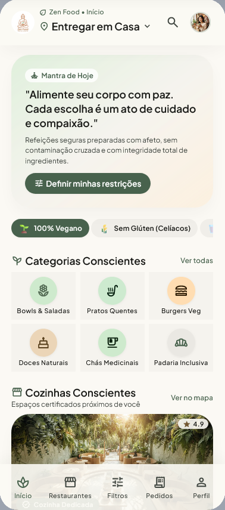
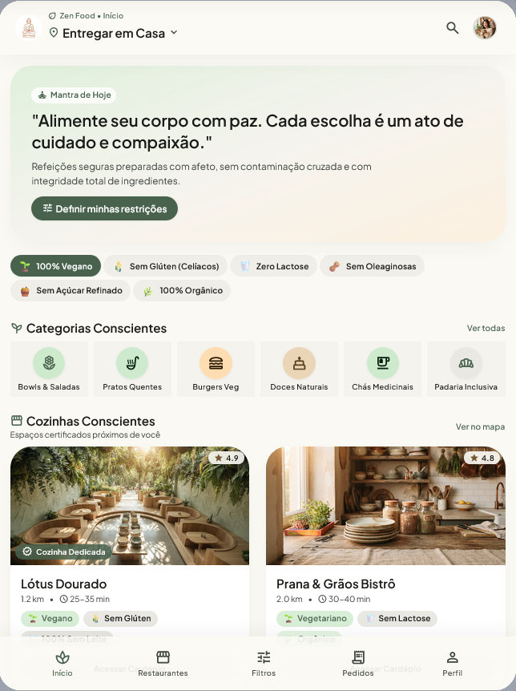
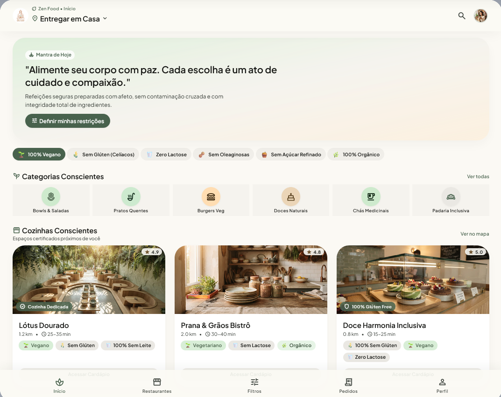
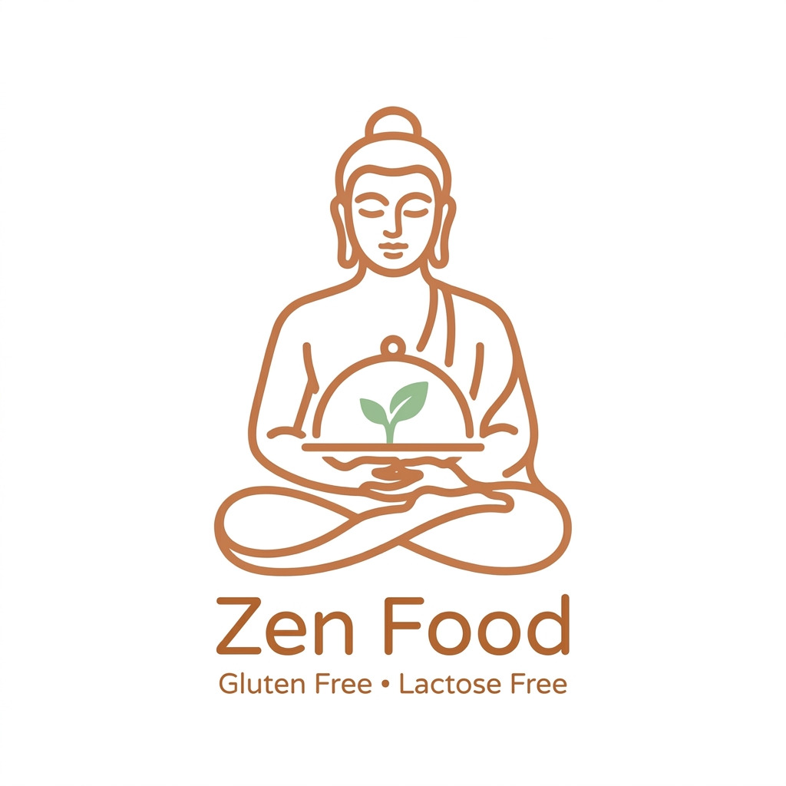
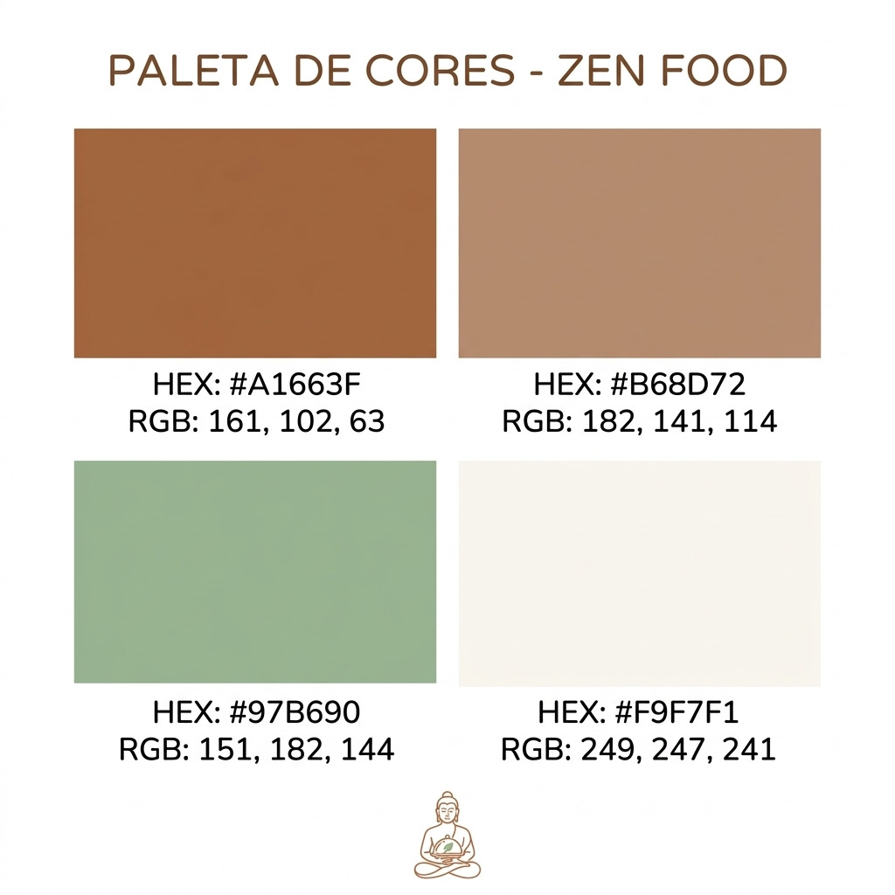
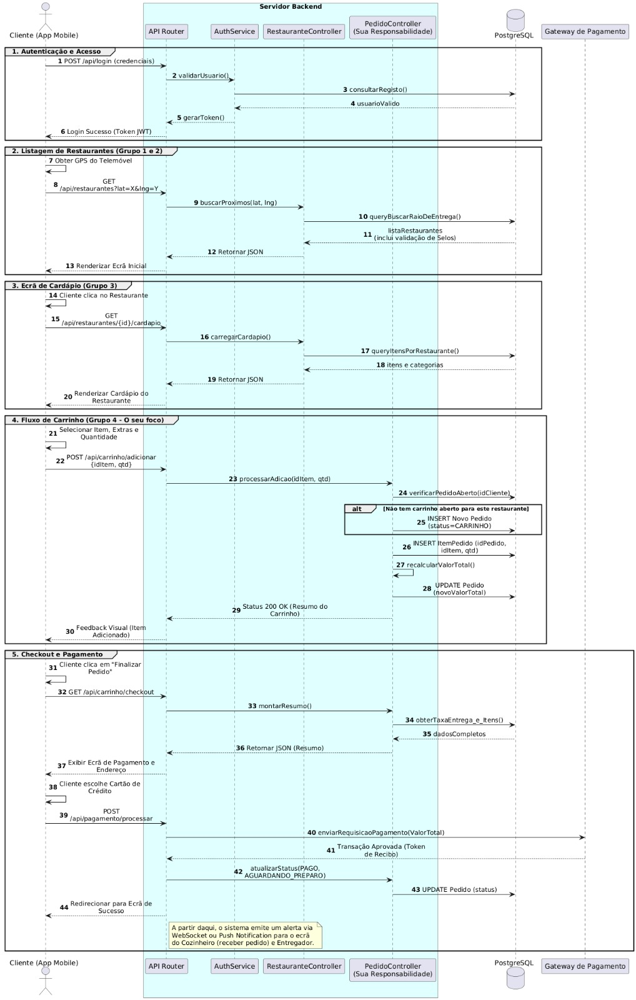

# Conteúdo da aula
Aula: 21/09

## Atividade de Simulação de Scrum.

Foi feito uma simulação de uma Sprint da criação de um aplicativo de Delivery:

Historia 1: **Visualizar Restaurantes**
Separação de atividades:

#### Cliente:
 - Professor Marcos

#### Product Owner
 - Vitor 

#### Scrum Master
 - Gabriel

#### Equipe de desenvolvimento
 - Tela inicial: Vinicius R.
 - Banco de dados: Manoel
 - Tela cardápio: Mateus e Allison
 - Criar Fluxo de pedido: Amanda e Felipe
 - Criar Logo e Id Visual: Tiago e Carlos

- - - 

### Link do Trello: 
> [trello.com](https://trello.com/b/hCzIwCOG/atv-gp)

### Infos pré-Disponiveis:  
> [BackLog do Produto](Docs/Backlog%20do%20Produto.docx).

> [Sprint 1](Docs/Sprint%201.docx).

- - - 

## O que foi feito: 

#### Tela Inicial





### Logo:



### Paleta de cores:




```Text
*Castanho Terracota / Bronze (Linhas, Buda e Texto "Zen Food"):*
    HEX: #B6693F
    RGB: rgb(182, 105, 63)

*Verde Sálvia / Folha (Folha dentro do prato):*
    HEX: #90A87A
    RGB: rgb(144, 168, 122)

*Fundo (Off-white / Bege Claro):*
    HEX: #FAF8F5
    RGB: rgb(250, 248, 245)
```

### UML do pedido

A uml está errada, mas foi algo que foi feito durante a aula.




### Também abordado:

Foi feito também a estrutura do `Banco de dados` e a Tela de cardapio, mas não foi finalizado 
